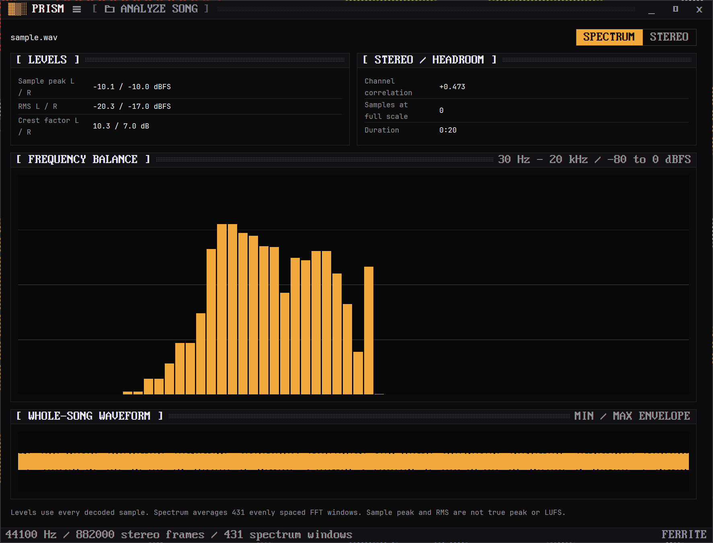

<p align="center">
  
</p>

<h1 align="center">Prism</h1>

<p align="center">
  A native Ferrite workbench for inspecting mono and stereo music bounces.
</p>

<p align="center">
  <a href="https://github.com/rwetz/ferrite-prism/actions/workflows/ci.yml"></a>
  <a href="https://github.com/rwetz/ferrite-prism/releases/latest"></a>
  <a href="LICENSE"></a>
</p>



- Open or drop a song. Analysis runs on a dedicated worker and never plays audio.
- Full-file sample peak, RMS, crest factor, stereo correlation and samples at or above full scale.
- Averaged logarithmic spectrum, sampled stereo vectorscope and whole-song min/max waveform.
- Silence has undefined correlation rather than a fabricated zero.
- Ctrl+O opens a file. Ctrl+Shift+P opens commands and theme choices. The menu button exposes the same commands.
- All ten Ferrite schemes and light/dark appearance persist per app. Window geometry is remembered.

## Install

Install through [Lodestone](https://github.com/rwetz/ferrite-lodestone), or download the Windows ZIP from [Releases](https://github.com/rwetz/ferrite-prism/releases). Lodestone discovers the public `ferrite-app` repository topic and verifies `SHA256SUMS.txt` before unpacking.

Windows binaries are released in this first scaffold. macOS/Linux packaging is queued.

## Supported files and limits

WAV (PCM), MP3, FLAC, OGG/Vorbis, AAC and M4A/AAC, mono or stereo. Files are limited to 256 MiB and 32 million decoded frames, approximately 11 minutes at 48 kHz. Surround and files that change sample rate are rejected. PCM is kept at its original gain for analysis. Corrupt files and missing audio devices report an error.

The spectrum uses stereo power, a 2048-sample Hann window and 64 logarithmic display bands. Offline spectrum averages up to 600 evenly spaced windows; full-file level measurements use every decoded sample. This is sample peak and RMS, **not** calibrated true peak, LUFS, or a mastering certification tool.

## Development

```powershell
cargo clippy --all-targets --locked -- -D warnings
cargo test --locked
cargo run -- --file "C:/Music/song.wav"
cargo run -- --smoke --file "C:/Music/song.wav"
```

The `--smoke` command decodes and measures a file without opening a window or playing sound. `--version` prints the packaged version.

Normal startup is empty and opens no browser or network service. Drag/drop and the native picker both use the same decoder.

## Roadmap

- Live microphone/interface input and Windows output capture, including driver-specific FL Studio verification.
- Selectable devices, performance controls and reusable shared audio analysis.
- Calibrated BS.1770 LUFS and oversampled true peak, live mix analysis, reference-track comparison and report export.

Shared Ferrite settings are queued separately; this release saves per-app preferences.

## Releases and licenses

A push to `main` prepares a unique version tag, builds and tests, then publishes a Windows archive and SHA-256 manifest. Explicit `v*` tags also release. Icon source is `assets/logo.svg`; regenerate the embedded Windows icon with `python scripts/generate-icon.py` (Pillow required).

Apache-2.0. Bundled font licenses and the Symphonia MPL-2.0 license accompany the binary. Symphonia 0.5.5 is used unmodified; its source is available from [the upstream project](https://github.com/pdeljanov/Symphonia) and [crates.io](https://crates.io/crates/symphonia/0.5.5). RustFFT is available under Apache-2.0 or MIT. See NOTICE and `assets/licenses/`.

## Settings

Open the sliders button in the title bar, press Ctrl+, or choose Settings from the command palette. All ten schemes, Dark/Light/System appearance, motion refresh rate (12 to 240 FPS), and row density apply immediately and persist per app. Save failures appear in Settings. Start with `--settings` to open the drawer directly. Ferrite launcher environment overrides take precedence at startup.

## Keys

| Keys | |
|---|---|
| <kbd>Ctrl</kbd>+<kbd>O</kbd> | Open a file |
| <kbd>Ctrl</kbd>+<kbd>Shift</kbd>+<kbd>P</kbd> | Command palette |
| <kbd>Ctrl</kbd>+<kbd>,</kbd> | Settings |

---

<p align="center">
  <picture>
    <source media="(prefers-color-scheme: dark)" srcset="docs/brand/heptagram-white.svg">
    
  </picture>
</p>
